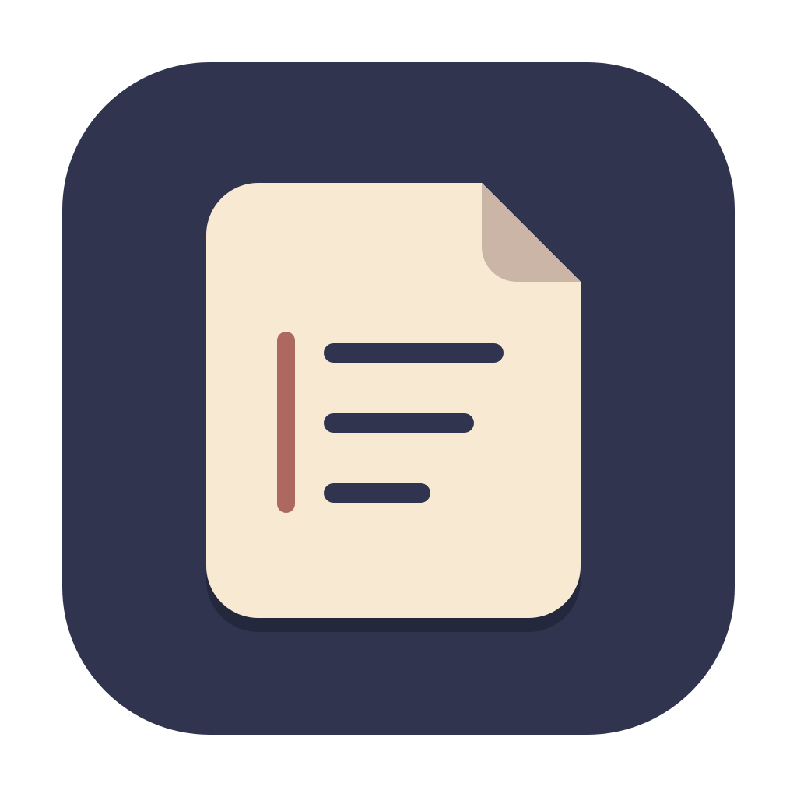
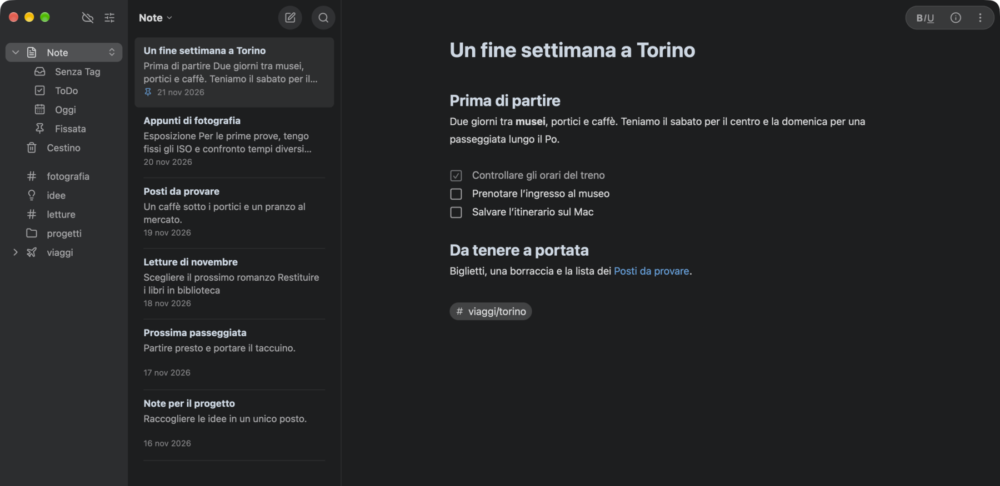
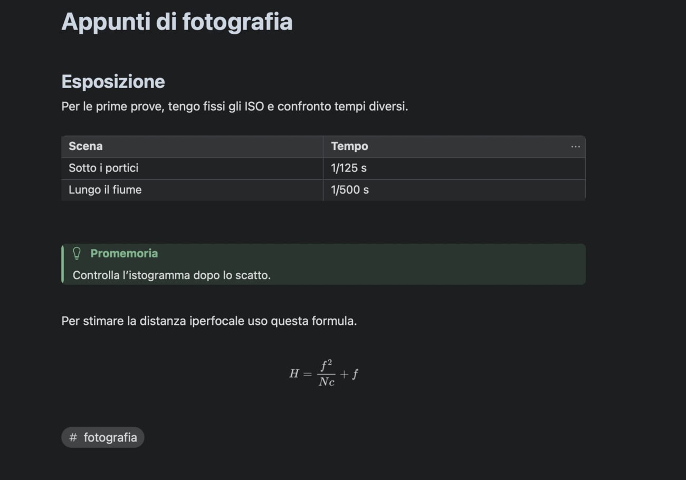

<p align="center">
  
</p>
<h1 align="center">Polar</h1>
<p align="center">A local Markdown editor for macOS inspired by Bear, with an interface in Italian.</p>



## Features

- **Write in Markdown.** Headings, emphasis, and checklists format as you type. Markdown markers reappear when you move the cursor into the text they format. Switch between editing and reading while keeping your place in the note.
- **Organize and find notes.** Use nested tags such as `#viaggi/idee`, pin notes to the top, or archive them. In the current section, combine keywords, quoted phrases, and filters such as `@todo "viaggio in treno" -completato`.
- **Link your notes.** In reading mode, follow links such as `[[Note title]]` or `[[Note title|alias]]`. The note info panel shows the heading outline, statistics, and backlinks.
- **Add rich content.** Insert tables, callouts, and images from the formatting menu. Write LaTeX equations and check off tasks directly in the editor.
- **Export notes.** Save individual notes as Markdown files. Polar copies linked images into a folder next to the exported file.



## On-device revision

Choose **Organizza appunti** (Organize Notes) from **Modifica** (Edit) or the note’s **…** menu. With no selection, Polar organizes the body of the current note in sections, preserving the title and protected Markdown such as links, code, and nested lists. Select complete blocks to limit the action to a passage. **Correggi selezione** (Correct Selection) works on the blocks you select. Switch between **Proposta** and **Originale** in the preview. Choose **Applica** (Apply) to confirm, press **⌘Z** to undo, or press **Esc** to close the preview.

Revision uses the Apple Intelligence system model on your Mac. It requires Apple silicon, macOS 26.4 or later, and Apple Intelligence turned on. Corrections can miss typos, and Polar may reject a proposed edit. See the [on-device revision evaluation](docs/local-revision-evaluation.md) for test results.

## Roadmap

- [ ] **Command-line tool.** List, search, read, create, and export notes from the terminal. Provide JSON output for scripts.
- [ ] **Local MCP server.** Let Model Context Protocol clients search and read notes over standard input and output (`stdio`). Start with read-only access and share the note operations with the CLI.
- [ ] **Real-time speech-to-text.** Stream microphone dictation into a live preview and insert the transcript into the current note when confirmed. Use voxmlx to run Voxtral Mini 4B Realtime locally on Apple silicon with MLX. See the [voxmlx project](https://github.com/awni/voxmlx) and the [Voxtral model card](https://huggingface.co/mistralai/Voxtral-Mini-4B-Realtime-2602).

## Build from source

You'll need macOS, Rust 1.97.1, Xcode, ImageMagick, and Python 3. Building the on-device revision helper requires the macOS 27 SDK or later.

```sh
cargo test --workspace --locked
./packaging/bundle.sh
open target/Polar.app
```

The script produces an ad hoc signed app bundle. Use `./packaging/bundle.sh debug` for a development build.

## Local storage

For a new archive, Polar stores `notes.json` and the `attachments/` directory in `~/Library/Application Support/Polar/`. If the Polar directory is absent, the app looks for Rigaquieta and then OpenBear and reopens the first archive in place. Set `POLAR_DATA_DIR` to use a separate archive.

## Keyboard shortcuts

| Action | Shortcut |
| --- | --- |
| Create a note | ⌘N |
| Search the current section | ⌘F |
| Switch between editing and reading | ⇧⌘M |
| Pin or unpin a note | ⇧⌘P |
| Move a note to Trash or restore it | ⇧⌘⌫ |
| Cycle through pane layouts | ⇧⌘L |
| Export as Markdown | ⇧⌘E |

Polar is built with Rust, GPUI, and AppKit. See the [editor performance measurements](docs/editor-performance.md) and [MathJax notes](vendor/mathjax/README.md) for technical details.
